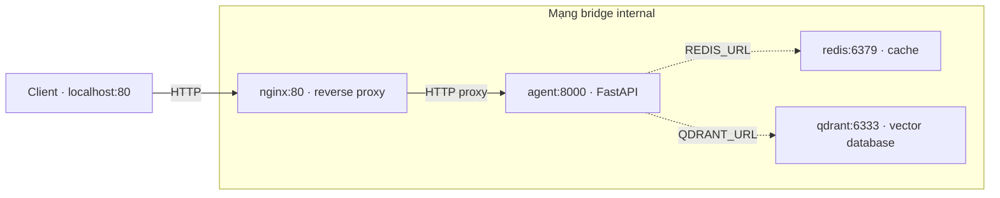

# Day 14 — Mission Answers

## Part 1 — Localhost vs Production

### Exercise 1.1 — Anti-patterns

Nguồn: [`01-localhost-vs-production/develop/app.py`](01-localhost-vs-production/develop/app.py).

| Vị trí | Vấn đề | Hậu quả khi đưa lên production |
| --- | --- | --- |
| Dòng 17–18 | API key và chuỗi kết nối có mật khẩu được ghi thẳng trong mã nguồn. | Nếu dùng thông tin thật, người có quyền đọc repo hoặc lịch sử commit có thể lấy được credential. Đổi key hoặc mật khẩu cũng phải sửa mã nguồn và triển khai lại. |
| Dòng 33–38 | App dùng `print()` để ghi câu hỏi, API key và câu trả lời. | Dữ liệu người dùng và key có thể bị lưu vào log. Log dạng văn bản rời cũng khó lọc theo trường hoặc mức độ khi điều tra lỗi. |
| Dòng 25–39 | App chỉ khai báo `GET /` và `POST /ask`, thiếu endpoint health check riêng. | Nền tảng không có endpoint chuyên dụng để kiểm tra liveness. Route `GET /` chỉ trả lời chào nên cũng không cho biết agent đã sẵn sàng xử lý request hay chưa. |
| Dòng 51–52 | Uvicorn bind vào `localhost` và dùng cổng cố định 8000. | Proxy ở ngoài container không thể kết nối vào địa chỉ loopback của app. Nếu nền tảng cấp cổng qua `PORT`, app vẫn nghe ở 8000 nên có thể không nhận được traffic. |
| Dòng 53 | Uvicorn bật `reload=True`, tùy chọn tự nạp lại dành cho phát triển. | App chạy thêm tiến trình theo dõi file. Nếu mã nguồn thay đổi, worker có thể khởi động lại ngoài quy trình triển khai, gây gián đoạn dịch vụ. |

### Exercise 1.2 — Chạy bản develop

`app.py` được chạy từ thư mục `01-localhost-vs-production/develop/` trong Ubuntu WSL2, với các gói từ `requirements.txt` được cài trong môi trường Python riêng.

```bash
curl -i -X POST 'http://localhost:8000/ask?question=Hello'
```

Kết quả thực tế (trích):

```http
HTTP/1.1 200 OK
content-type: application/json

{"answer":"Tôi là AI agent được deploy lên cloud. Câu hỏi của bạn đã được nhận."}
```

Endpoint nhận `question` qua query string và trả JSON chứa câu trả lời của mock LLM. HTTP 200 xác nhận luồng hỏi đáp hoạt động trên máy local. Trước khi đưa app lên production, cần xử lý các vấn đề ở Exercise 1.1.

### Exercise 1.3 — So sánh develop và production

| Tiêu chí | Develop | Production | Vì sao quan trọng? |
| --- | --- | --- | --- |
| Cấu hình | Ghi API key và chuỗi kết nối trong code, bind vào `localhost:8000`, luôn bật reload (`app.py`, dòng 17–22 và 47–54). | `config.py` đọc `HOST`, `PORT`, `DEBUG` và các key từ biến môi trường. Mặc định bind `0.0.0.0` và tắt reload. | Cùng một bản build có thể chạy ở nhiều môi trường. Nền tảng có thể cấp cổng và cấu hình secret bên ngoài mã nguồn. |
| Health check | Có `GET /` trả lời chào. | `GET /health` trả trạng thái và uptime. `GET /ready` trả 200 khi cờ readiness được bật, 503 khi chưa sẵn sàng (`app.py`, dòng 135–161). | Liveness giúp nền tảng phát hiện tiến trình có vấn đề. Readiness giúp bộ cân bằng tải chọn instance đã sẵn sàng nhận request. |
| Logging | Dùng `print()` và ghi cả API key, nội dung câu hỏi và câu trả lời (`app.py`, dòng 33–38). | Dùng `logging` với định dạng hướng đến JSON. Log hỏi đáp ghi tên sự kiện, độ dài câu hỏi hoặc câu trả lời và IP ở sự kiện request (`app.py`, dòng 27–32 và 110–122). | Tên sự kiện và mức log giúp lọc khi điều tra lỗi. Việc bỏ key và nội dung hỏi đáp khỏi log giảm nguy cơ lộ dữ liệu. |
| Graceful shutdown | Không có hook shutdown riêng của ứng dụng. | Uvicorn xử lý quá trình dừng server. Hook `lifespan` chuyển cờ readiness về `False` và ghi log shutdown (`app.py`, dòng 39–74 và 180–189). | Hook tạo điểm để dọn tài nguyên khi dừng app. Graceful shutdown giúp các request đang xử lý có thời gian hoàn tất trước khi tiến trình thoát. |

Kiểm tra bản `production` trong Ubuntu WSL2 bằng cấu hình mặc định. `GET /health`, `GET /ready` và `POST /ask` với JSON `{"question":"Hello"}` đều trả HTTP 200. Sau khi gửi SIGTERM lúc server đang rảnh, Uvicorn ghi `Application shutdown complete.` và tiến trình thoát với mã 0.

## Part 2 — Docker

### Exercise 2.1 — Dockerfile cơ bản

1. **Base image.** `FROM python:3.11` dùng image Python chính thức với Python 3.11 làm nền cho image của agent.
2. **Working directory.** `WORKDIR /app` đặt thư mục làm việc bên trong container là `/app`. Đích tương đối `.` trong các lệnh `COPY` trỏ đến thư mục này. Khi container khởi động, `python app.py` cũng chạy từ đây.
3. **Thứ tự copy.** Docker copy `requirements.txt` rồi chạy `pip install` trước khi copy mã nguồn. Nếu chỉ sửa `app.py` và các bước trước đó vẫn có cache, Docker có thể dùng lại lớp đã cài dependencies. Khi `requirements.txt` thay đổi, bước cài dependencies sẽ chạy lại.
4. **`CMD` và `ENTRYPOINT`.** `CMD ["python", "app.py"]` cung cấp lệnh mặc định. Dockerfile này dùng `CMD` để khởi động agent. Lệnh đặt sau tên image trong `docker run` có thể thay thế giá trị `CMD`. Nếu cấu hình `ENTRYPOINT` ở dạng exec, nó xác định chương trình chính và `CMD` có thể cung cấp đối số mặc định cho chương trình đó. Dùng `--entrypoint` để ghi đè `ENTRYPOINT`.

### Exercise 2.2 — Build và chạy container

Các lệnh được chạy từ gốc repo trong Ubuntu WSL2:

```bash
docker build -f 02-docker/develop/Dockerfile -t my-agent:develop .
docker run --rm -d -p 127.0.0.1:8000:8000 my-agent:develop
curl -i -X POST 'http://localhost:8000/ask?question=What%20is%20Docker%3F'
docker images my-agent:develop
```

Kết quả gọi agent (trích):

```http
HTTP/1.1 200 OK
content-type: application/json

{"answer":"Container là cách đóng gói app để chạy ở mọi nơi. Build once, run anywhere!"}
```

Kết quả `docker images my-agent:develop` (trích):

```text
IMAGE              ID             DISK USAGE   CONTENT SIZE   EXTRA
my-agent:develop   d4ffcc414c99       1.15GB             0B   U
```

Dung lượng ghi nhận ở cột `DISK USAGE` là **1.15 GB**. Container được dừng và tự xóa sau khi kiểm tra.

### Exercise 2.3 — Multi-stage build

1. **Stage 1 · Builder.** Dùng `python:3.11-slim`, cài `gcc` và `libpq-dev` để hỗ trợ build dependency khi cần. Sau đó, `pip install --user` cài các gói Python từ `requirements.txt` vào `/root/.local`.
2. **Stage 2 · Runtime.** Bắt đầu từ một image `python:3.11-slim` mới, copy các gói Python đã cài sang `/home/appuser/.local` và thêm mã nguồn. Uvicorn chạy dưới tài khoản `appuser`.
3. **Vì sao image nhỏ hơn?** Runtime dùng base image `slim` và chỉ lấy gói Python cần để chạy từ builder. Các công cụ build như `gcc` và gói header `libpq-dev` nằm ở stage builder.

Các lệnh build và đo dung lượng được chạy từ gốc repo:

```bash
docker build -f 02-docker/production/Dockerfile -t my-agent:advanced .
docker images my-agent
docker image inspect --format '{{.RepoTags}} {{.Size}}' my-agent:develop my-agent:advanced
```

Kết quả `docker images` (trích):

```text
IMAGE               ID             DISK USAGE   CONTENT SIZE   EXTRA
my-agent:advanced   306087538fa9        163MB             0B
my-agent:develop    d4ffcc414c99       1.15GB             0B   U
```

`docker image inspect` ghi nhận **1.154.311.927 byte** cho bản `develop` và **162.892.338 byte** cho bản `advanced`. Tính theo số byte trước khi làm tròn, dung lượng giảm **85,89%** theo công thức `(1 − 162892338 / 1154311927) × 100`.

### Exercise 2.4 — Docker Compose stack



Compose chạy bốn service trên cùng mạng bridge. Nginx nhận HTTP từ cổng 80 của host và chuyển tiếp đến `agent:8000` theo tên service. Compose chờ Redis và Qdrant đạt trạng thái healthy trước khi khởi động agent. Các mũi tên nét đứt thể hiện URL được cấu hình cho agent. Endpoint `/ask` trong mẫu gọi mock LLM trực tiếp.

Các lệnh chạy trong `02-docker/production/`:

```bash
touch .env.local
docker compose -p k5-day14-docker up -d --build --wait --wait-timeout 120
docker compose -p k5-day14-docker ps
curl -i http://localhost/health
curl -i -X POST http://localhost/ask \
  -H 'Content-Type: application/json' \
  -d '{"question":"Explain microservices"}'
docker compose -p k5-day14-docker down
```

Kết quả `docker compose ps` xác nhận `agent`, `redis` và `qdrant` đều `Up (healthy)`, còn `nginx` ở trạng thái `Up`.

`GET /health` qua Nginx (trích):

```http
HTTP/1.1 200 OK
Server: nginx
Content-Type: application/json

{"status":"ok","uptime_seconds":4.5,"version":"2.0.0","timestamp":"2026-11-25T08:12:00.563693"}
```

`POST /ask` qua Nginx (trích):

```http
HTTP/1.1 200 OK
Server: nginx
Content-Type: application/json

{"answer":"Tôi là AI agent được deploy lên cloud. Câu hỏi của bạn đã được nhận."}
```

